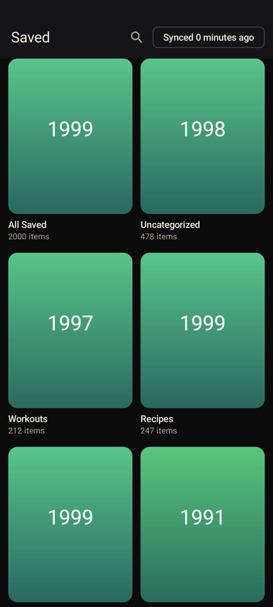
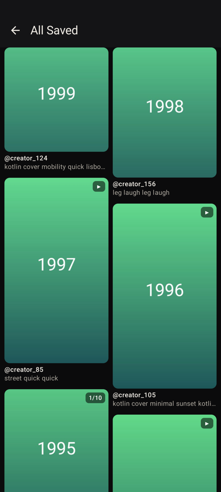
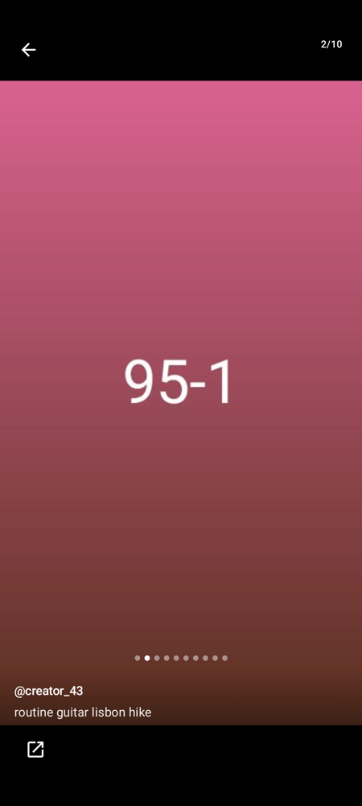

# reels

A personal Android app that syncs the saved reels and posts of a **throwaway Instagram account**, with their
collections, and shows them Pinterest-style: a staggered grid of real thumbnails, grouped by collection, and a
full-screen viewer for reels and carousels. Kotlin and Jetpack Compose, one user, no server.

<p align="center">
  
  
  
</p>
<p align="center"><sub>Mock mode on an emulator: every picture, handle and caption is generated fake data.</sub></p>

> [!WARNING]
> **Read this before you use it.**
> - It reads Instagram through its **private web endpoints**, with a logged-in session. That is against Instagram's Terms
>   of Service, and the account can be challenged, limited or banned. Log in with a **throwaway account** only, never
>   your main one.
> - It is a personal project: not on any app store, never distributed as an APK, and no support or fixes are promised.
>   Instagram can break it at any time.
> - Everything stays on the phone: no server, no cloud, no analytics or telemetry, and Android backup is off. The
>   session lives only in the WebView's own cookie store.
> - Sync is manual and deliberately slow: one request at a time, a random 4–12 s apart (about 6 s typically), a
>   60–180 s break after every 15–30 requests, and at most **300 requests per run** and **600 per rolling 24 hours**. A
>   rate limit stops every Instagram request for 1 hour, and a second one within 24 hours for 24 hours.

## What it is

reels copies the saved items of one Instagram account onto the phone and lets you browse them by collection, search
them and watch them, also offline. It reaches Instagram the way the website does, from a hidden instagram.com page inside
the app, and it paces every request itself.

- **It does:** list your collections under their Instagram names; sync new saves (**Sync**) and, when you ask, mirror
  unsaves and moves between collections (**Full sync**); play reels and swipe carousels; keep thumbnails, viewed pictures
  and watched videos on the phone.
- **It doesn't:** post, like, unsave or change anything on Instagram (it only reads); sync on a schedule (nothing runs
  until you tap a button); download videos during a sync (a reel is fetched when you open it); handle more than one
  account at a time.

## Features

- **Collections with their names.** Saved lists All Saved, Uncategorized and every collection under its Instagram name,
  each with its item count. Instagram's automatic collections ("All posts", audio) are left out.
- **Pinterest-style grid.** Two columns, staggered, at each post's real aspect ratio, with a ▶ badge on videos and "1/N" on
  carousels, paged from the local database.
- **The viewer.** Swipe up and down between posts. Reels play on demand and loop, and mute is remembered. Carousels swipe
  sideways with a counter and dots; an open carousel fetches its other pictures ahead, one at a time, and each video item
  gets its poster and its first megabyte ahead, so it starts quickly. **Open on Instagram** hands the link to whatever app
  handles it. A post grows out of its tile and shrinks back into it, with predictive back.
- **Offline cache.** Thumbnails and carousel pictures are kept as files; videos go into a 512 MB least-recently-used
  cache keyed by the post, so a reel watched through once plays with no network, even after its link has expired.
- **Search.** Full-text search (SQLite FTS4) over captions, authors and collection names, narrowed to reels or posts and
  to a collection.
- **Careful sync.** It runs as a WorkManager foreground worker, so you can leave the app; it pauses and resumes from
  its place; it stops at once on a challenge or an expired session; and it deletes only after a complete walk, refusing a
  Full sync that would remove at least 20 items and more than half of the library at once.
- **Self-repairing collection names.** The names come from the website's own GraphQL query. When Instagram changes that
  query's id, a second hidden page views your Saved page once in desktop mode (at most every 24 hours), learns the new id
  from the site's own request, and the sync goes on; if that fails, the last names are kept.
- **Pacing and budgets.** One Pacer gates every API request: the numbers in the warning above, a 2 s minimum gap for the
  requests you wait for in the viewer, and image downloads (and carousel video starts) at most 2 at a time, after a
  short random pause. Budgets and
  cooldowns survive an app restart.
- **Mock mode.** Debug builds start on a generated library of 2,000 fake items in 8 collections, with placeholder
  pictures and a bundled clip, so the whole app works without Instagram.
- **Adapter lab** (debug builds only). One request per endpoint, showing the answer's redacted shape and saving a
  scrubbed copy, to check the parsers against what Instagram really sends.

## How it works

```text
  Saved · Grid · Viewer · Search · Sync              (Jetpack Compose screens)
       │ read            │ Sync, Full sync           │ link renewals, session checks, lab
       ▼                 ▼                           │
  Room database ◄─── SyncEngine                      │
                writes   (WorkManager worker)        │
                         │ InstagramClient           │
                         ▼   (:instagram)            │
                       Pacer ◄───────────────────────┘
                       gaps, breaks, budgets, cooldowns
                         │
              ┌──────────┴──────────────────────┐
              ▼                                 ▼
    API calls (sync lane,              CDN lane, no cookies:
    interactive lane):                 thumbnails, carousel pictures,
    WebViewTransport, one fetch        the first MB of carousel videos
    per call in a hidden
    instagram.com page
```

- **`:instagram`** is a pure Kotlin/JVM module and the only place that knows Instagram: endpoints, headers, GraphQL,
  pagination, JSON parsing and error classification, behind the `InstagramClient` contract, plus the fake client for Mock
  mode. `:app` builds no Instagram URL and parses no Instagram JSON; the few names its page scripts repeat are pinned to
  `:instagram`'s constants by tests.
- **Hidden-WebView transport.** Every API call (a sync, a session check, the viewer's link renewal, the lab) runs as a
  `fetch` inside a hidden instagram.com page, with the same browser engine and cookies as the login screen, the way the
  website sends it. The page closes after 5 idle minutes.
- **Pacer.** A sync lane (the gaps, breaks and budgets above), an interactive lane that goes first (the viewer and the
  session check, at least 2 s after the last request), and a CDN lane for downloads, which are not API requests. Every API
  request is recorded in a request log behind the 24-hour budget.
- **Room** holds the library (posts, collections, memberships, carousel items, runs, the request log); the screens read
  it, the grid and the viewer through Paging. A debug build's fake library and the real one are separate databases.
- **Media3** plays videos through its own cache (`SimpleCache`, 512 MB); an expired link is renewed with one paced
  request, and only under a valid session.

[`ARCHITECTURE.md`](ARCHITECTURE.md) has the full picture.

## Requirements

- **Android Studio**, for its bundled JDK, the Android SDK and the emulator. The build has only been run with Android
  Studio's own JDK (JetBrains Runtime 25); it compiles to Java 17.
- **Android SDK Platform 37** (the build compiles against API 37) and **Platform-Tools** (`adb`), from Android
  Studio's SDK Manager. The app targets API 36 and runs on Android 10 (minSdk 29) and newer; the instrumented tests run on
  an API 37 emulator.
- Gradle 9.8 comes with the wrapper (`./gradlew`); AGP 9.4.1, Kotlin 2.4.20 and the other versions are pinned in
  [`gradle/libs.versions.toml`](gradle/libs.versions.toml).

Every Gradle command needs `JAVA_HOME` and `ANDROID_HOME`. Set both in each new terminal, with your own paths:

```bash
export JAVA_HOME="<Android Studio>/jbr" ANDROID_HOME="<Android SDK>" PATH="$PATH:<Android SDK>/platform-tools"
```

The usual places: on macOS, `JAVA_HOME` is `/Applications/Android Studio.app/Contents/jbr/Contents/Home` and the SDK is
`$HOME/Library/Android/sdk`; on Linux, `JAVA_HOME` is the `jbr` folder inside Android Studio's folder and the SDK is
`$HOME/Android/Sdk`. Instead of `ANDROID_HOME` you can put `sdk.dir=<Android SDK>` in `local.properties` (gitignored).

## Try it without an Instagram account

A debug build starts in **Mock mode**: it shows the fake library, and **Sync** fills it with generated items. It never
contacts Instagram unless you tap **Log in**, **Paste sessionid**, **Check now**, **Open on Instagram** or the
**Adapter lab**.

```bash
git clone https://github.com/YuriiMurha/reels.git
cd reels
./gradlew assembleDebug
```

Then, with **one** emulator running (create one in Android Studio's Device Manager), install it there only:

```bash
SERIAL="$(adb -e get-serialno)" && ANDROID_SERIAL="$SERIAL" ./gradlew installDebug
```

Open **Reels**, tap **Open Sync** (or the status chip, top right), then **Sync**. On a phone, turn on USB debugging and
use `adb -d` in place of `adb -e`. Always pass `ANDROID_SERIAL`: a bare `installDebug` installs on every device attached.

**Tests.** The JVM unit tests of both modules (Robolectric for the Android parts):

```bash
./gradlew :instagram:test :app:testDebugUnitTest
```

Everything at once, the same unit tests plus Android lint:

```bash
./gradlew check
```

The instrumented tests: a smoke suite that drives the real UI, and the hidden-page tests against a local server. They
run on an emulator only (every test skips on a physical phone), and the smoke suite needs Mock mode on:

```bash
SERIAL="$(adb -e get-serialno)" && ANDROID_SERIAL="$SERIAL" ./gradlew connectedDebugAndroidTest
```

It leaves the app installed and saves a screenshot per step on the emulator ([`docs/GUIDE.md`](docs/GUIDE.md), section 3).

## Using it with a (throwaway) account

On a real phone, roughly: install the debug build over USB; on **Sync → Developer**, switch **Mock mode** off (the app
restarts on the empty real library); under **Instagram session**, tap **Log in** and log in to the throwaway account in
Instagram's own page (2FA included); then tap **Sync**. A run of 300 requests takes roughly an hour, so a library of a few
thousand saves needs several runs; **Resume** carries on where one stopped. Run a **Full sync** only after a plain Sync has
succeeded: it is the only sync that removes items. A release build (`installRelease`) is minified, has no Mock mode and
is signed with the debug key unless you add your own.

The full procedure, with the checks, the limits, every banner and message, and troubleshooting, is in
[**`docs/GUIDE.md`**](docs/GUIDE.md): sections 1–5 for the first run, 6 for videos and carousels, 7 for the Adapter lab,
8 for the on-phone checklists, 9 for the release build and 10 for troubleshooting. It is written for the owner's Mac.

## Project layout

```text
app/                          :app, the Android app
  src/main/kotlin/io/github/yuriimurha/reels/
    data/                     Room database, library, thumbnails, carousels, video cache, settings (DataStore)
    di/                       AppContainer: hand-wired dependencies, the fake or the real backend, Mock mode
    session/                  session state (the session itself lives only in the WebView's cookie store)
    sync/                     SyncEngine, the WorkManager worker, the collection-names repairer
    sync/pacing/              Pacer, PacingPolicy, request log, cooldowns
    transport/                the hidden WebView pages: API calls and the names repair
    ui/                       Compose screens: home, grid, viewer, search, sync, login, lab
  src/main/assets/            ig_fetch.js and ig_watch.js, the hidden pages' scripts
  src/test/                   JVM and Robolectric tests
  src/androidTest/            emulator-only smoke suite and hidden-page tests
  schemas/                    exported Room schemas
instagram/                    :instagram, pure Kotlin/JVM, the only module that knows Instagram
  src/main/kotlin/io/github/yuriimurha/reels/instagram/
    web/                      endpoints, headers, GraphQL, parsers, error classification
    fake/                     FakeInstagramClient and the generated FakeLibrary
    lab/                      Adapter lab core: shape dumps and scrubbing
docs/                         the guide, design specs, implementation plans, screenshots
.githooks/pre-commit          the secret guard
scripts/test-secret-guard.sh  the guard's own test
```

## Docs

- [`docs/GUIDE.md`](docs/GUIDE.md): running it on a real phone, step by step, with checklists and troubleshooting.
- [`ARCHITECTURE.md`](ARCHITECTURE.md): the app as it exists now, component by component, and the decisions behind it.
- [`TODO.md`](TODO.md): the plan, the milestones and what is still open.
- [`PROGRESS.md`](PROGRESS.md): the dated history, append-only.
- Design specs in [`docs/superpowers/specs/`](docs/superpowers/specs/): the
  [app](docs/superpowers/specs/2026-10-06-saved-reels-android-design.md), the
  [WebView transport](docs/superpowers/specs/2026-10-08-webview-transport-design.md), the
  [collection names](docs/superpowers/specs/2026-10-09-collection-names-design.md) and the
  [viewer update](docs/superpowers/specs/2026-10-12-viewer-ux-design.md). Their implementation plans are in
  [`docs/superpowers/plans/`](docs/superpowers/plans/).
- [`CLAUDE.md`](CLAUDE.md): the project's rules for coding agents.

## Contributing and forking

This is a personal project and is not looking for contributions, but you are welcome to fork it. If you do, keep its
rules, because the repo is public and every commit is published:

- **Never commit or log session material** (`sessionid`, cookies, CSRF tokens), HAR captures or raw Instagram responses.
- **Keep test fixtures scrubbed:** no real handles, captions or URLs, only synthetic ones.
- **Instagram code lives only in `:instagram`.** Endpoints, headers, pagination and JSON fields go there; the few names
  `:app` must repeat (in the hidden pages' scripts, and one origin) are listed in [`CLAUDE.md`](CLAUDE.md) and pinned by
  tests.
- **Pacing is a hard rule.** No change may raise request rates or concurrency without saying so explicitly, in the
  commit and in `ARCHITECTURE.md`.
- **Enable the pre-commit guard** once per clone. It refuses staged session material, cookie dumps and signing files:

  ```bash
  git config core.hooksPath .githooks
  ```

  `scripts/test-secret-guard.sh` checks the guard itself. **Never commit with `--no-verify`**; if the guard refuses a
  commit, remove what it found.
- Update `ARCHITECTURE.md` in the same commit as the code it describes, and add to `PROGRESS.md` without editing past
  entries.

## License

[MIT](LICENSE), © 2026 Yurii Murha. The viewer's three Material Symbols glyphs are © Google LLC under the Apache License
2.0; their notice is in [`app/src/main/res/raw/license_material_symbols.txt`](app/src/main/res/raw/license_material_symbols.txt).
